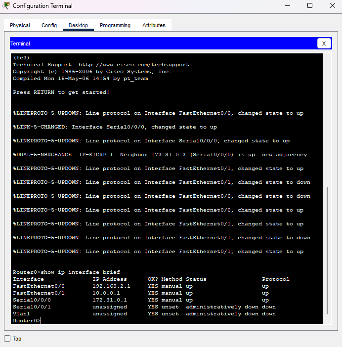
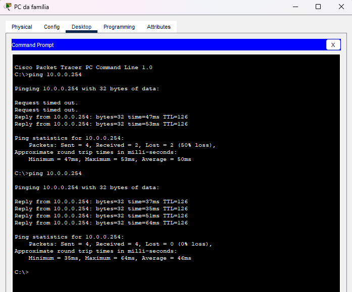
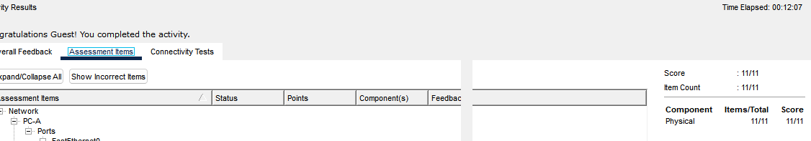
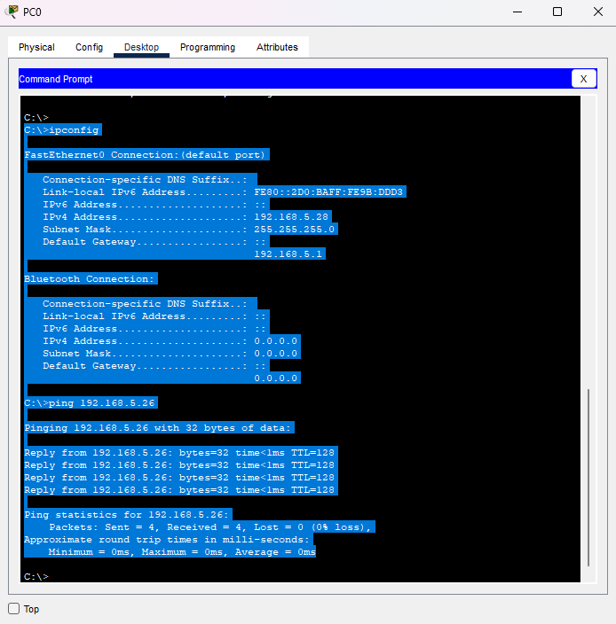
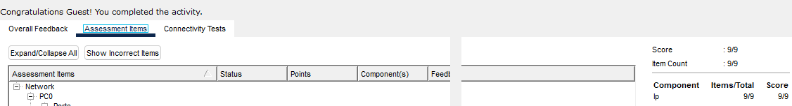
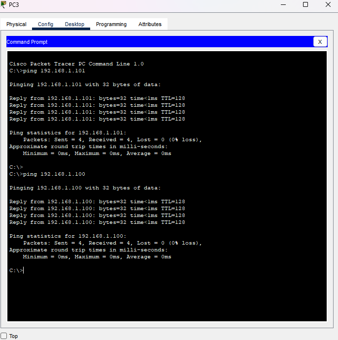

# Fundamentos de rede no Packet Tracer: cabeamento, DHCP, NAT e documentação

> Série de laboratórios 001–004 e 007 · mar/2025 a mai/2025 · Evidência direta (captura de tela própria ou saída de terminal copiada na entrega)
>
> Página no portfólio: https://juli084.github.io/cybersecurity-portfolio/laboratorios/fundamentos-de-redes/

## Objetivo

Cinco atividades iniciais do curso: escolher o cabo certo para cada enlace, montar um rack a partir de um diagrama, configurar DHCP, observar NAT e documentar o endereçamento de uma rede.

- Selecionar a mídia correta para cada tipo de enlace e verificar a conectividade
- Conectar equipamentos em rack seguindo um diagrama lógico
- Alterar o escopo de DHCP de um roteador sem fio e validar nos clientes
- Distinguir endereço público de privado e observar a tradução feita pelo NAT
- Registrar o endereçamento de uma rede em um relatório de mapeamento

## Cenário

Foram as primeiras práticas do curso, todas em rede simulada. Reuni as cinco numa página porque cada uma, sozinha, é pequena. Juntas, mostram a base sobre a qual os laboratórios de segurança foram construídos.

## Ambiente

- Cisco Packet Tracer (rede simulada)

## Tecnologias

IPv4, DHCP, NAT, ICMP, Ethernet

## Ferramentas

Cisco Packet Tracer, Cisco IOS

## Procedimento

1. 001: conectei nuvem, modem, dois roteadores, switch, roteador sem fio e PCs com cabo direto, cruzado, serial, coaxial e de console. Testei com ping e com show ip interface brief pelo terminal de console.
2. 002: preenchi a tabela de dispositivos, interfaces e portas a partir do diagrama e fiz o cabeamento no rack, no modo físico.
3. 003: mudei o IP do roteador sem fio, o endereço inicial e o número máximo de clientes do DHCP, renovei o endereço nos três PCs e testei ping entre eles.
4. 004: levantei rede, máscara, gateway, faixa DHCP, DNS e a tabela de dispositivos e interfaces de uma rede doméstica.
5. 007: identifiquei o endereço público e a faixa privada no roteador, conectei quatro PCs por DHCP e acompanhei um pedido HTTP no modo de simulação para ver o endereço de origem mudar.

## Evidências

*001: acesso ao roteador pelo cabo de console. As interfaces sobem conforme os cabos são conectados e o show ip interface brief confirma o estado de cada uma.*

*001: ping de um PC para o servidor do outro lado da topologia. Os primeiros pacotes expiram enquanto o ARP é resolvido.*

*002: atividade do rack concluída, 11 de 11 itens.*

*003: cliente com endereço da nova faixa e ping para outro PC da mesma rede.*

*003: atividade de DHCP concluída, 9 de 9 itens.*

*007: conectividade entre os PCs atrás do roteador sem fio antes de observar o NAT.*

## Análise técnica

| Atividade | O que ela exercita | Como verifiquei |
| --- | --- | --- |
| 001 Cabeamento | Cabo direto, cruzado, serial, coaxial e console | Luz de enlace, ping e `show ip interface brief` |
| 002 Rack | Leitura de diagrama lógico e conexão física | Pontuação da atividade |
| 003 DHCP | Escopo, endereço inicial e limite de clientes | `ipconfig` e ping em cada PC |
| 004 Mapeamento | Rede, máscara, gateway, DNS, interfaces | Tabela conferida contra o cenário |
| 007 NAT | Endereço público e privado, tradução | Cabeçalhos no modo de simulação |

Na 003, depois de trocar o IP do roteador, os PCs continuaram com o endereço antigo até eu forçar a
renovação. O cliente só pede novo endereço quando a concessão vence ou quando alguém manda, então
mudar o servidor não muda os clientes na hora.

Na 007, o roteador recebe um endereço do provedor na porta externa e distribui endereços privados
na interna. O pedido HTTP sai do PC com o endereço privado como origem e chega ao servidor com o
endereço externo do roteador. É por isso que vários equipamentos compartilham um único endereço
público, e também por isso que, de fora, não dá para iniciar uma conexão com um deles sem uma regra
que diga para qual encaminhar.

## Resultado

Quatro das cinco atividades foram concluídas. A 001 ficou em 50 de 80 pontos, com 10 de 16 itens corretos, e está registrada aqui como incompleta.

## O que aprendi

O cabo errado derruba o enlace antes de qualquer configuração importar, e o ipconfig e o ping resolvem a maior parte das dúvidas iniciais. Na 007, ver o endereço de origem mudar no cabeçalho deixou claro por que um endereço privado nunca aparece do lado de fora.

## Competências demonstradas

- `midias-e-topologia`
- `dhcp`
- `nat`
- `enderecamento-ipv4`
- `documentacao-tecnica`

A relação entre competências e laboratórios está em [docs/skills-matrix.md](../../docs/skills-matrix.md).

## Referências

- [RFC 2131: DHCP](https://www.rfc-editor.org/rfc/rfc2131)
- [RFC 3022: NAT tradicional](https://www.rfc-editor.org/rfc/rfc3022)
- [RFC 1918: endereços privados](https://www.rfc-editor.org/rfc/rfc1918)

## Limitações

- 001 não foi concluída: 50 de 80 pontos.
- 004 não tem captura de tela nem o arquivo do cenário; ficou só a tabela.
- Na 007 não guardei a captura do cabeçalho antes e depois da tradução, que é a parte mais importante da atividade.

## Para reproduzir

- Cisco Packet Tracer e as atividades correspondentes do Cisco Networking Academy.
- Os arquivos de atividade pertencem à Cisco e não estão neste repositório.

## Considerações éticas

Atividade realizada em ambiente acadêmico, controlado e autorizado, com finalidade educacional. Veja [docs/ethics.md](../../docs/ethics.md).

---

*Arquivo gerado a partir de `lab.md` por `npm run readmes`. Edite o `lab.md`.*
