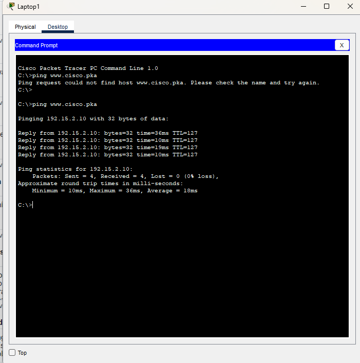
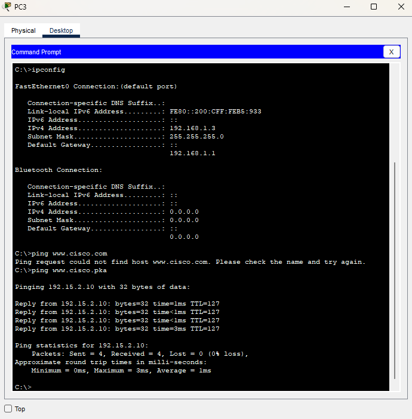
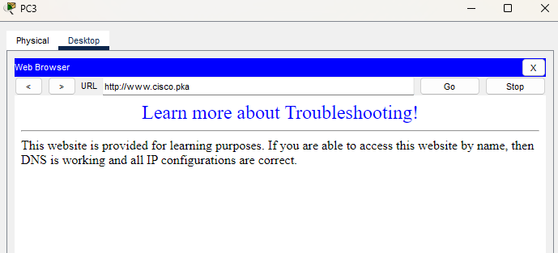
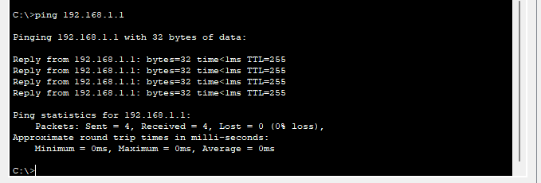

# Troubleshooting de conexão Wi-Fi em uma rede de biblioteca

> Laboratório 005 · mai/2025 a set/2025 · Evidência direta (captura de tela própria ou saída de terminal copiada na entrega)
>
> Página no portfólio: https://juli084.github.io/cybersecurity-portfolio/laboratorios/troubleshooting-wifi/

## Objetivo

Um laptop não acessava um site. Mapeei a rede, encontrei a causa no próprio laptop e no roteador sem fio, corrigi e verifiquei em todas as estações. Fiz o cenário duas vezes, com quatro meses de intervalo.

- Identificar a falha que impedia o acesso
- Corrigir os dispositivos mal configurados
- Verificar a correção em todas as estações

## Cenário

Em uma biblioteca, um usuário reclama que o laptop não abre um site. As outras estações usam DHCP. O trabalho é descobrir o que há de errado, corrigir e provar que ficou resolvido.

## Ambiente

- Cisco Packet Tracer (rede simulada)

## Tecnologias

WPA2, DHCP, DNS, ICMP, HTTP

## Ferramentas

Cisco Packet Tracer

## Procedimento

1. Montei o relatório de mapeamento com rede, máscara, gateway, faixa de DHCP, DNS e endereço de cada estação.
2. Comparei o laptop com problema com as estações que funcionavam.
3. Acessei a página de administração do roteador sem fio para ver a configuração da rede.
4. Conectei o laptop à rede sem fio com os parâmetros corretos e renovei o endereço.
5. Testei ping e navegador, por nome, em cada estação e no roteador.

## Evidências

*O laptop com problema. O primeiro ping nem resolve o nome; depois da correção, o nome é resolvido e o servidor responde.*

*Uma estação cabeada usada como referência, com endereço, gateway e resolução de nome funcionando.*

*Acesso por nome pelo navegador. A própria página diz que, se ela abriu, DNS e IP estão corretos.*

*Ping para o gateway, para separar problema de rede local de problema de resolução de nome.*

*Atividade concluída em 100%.*

## Análise técnica

A causa direta era simples: o laptop não estava associado à rede sem fio. Sem associação não há
endereço, sem endereço não há DNS, e o sintoma que o usuário vê é "o site não abre".

O que tornou o laboratório útil foi o que apareceu no caminho. Para conectar o laptop precisei
entrar na administração do roteador, e ali encontrei três problemas que não tinham relação com a
reclamação:

| Achado | Por que importa |
| --- | --- |
| Roteador com usuário e senha de fábrica | Qualquer pessoa na rede entra na administração; credenciais padrão são públicas |
| Endereço inicial do DHCP sujeito a conflito | Risco de dois equipamentos com o mesmo IP |
| Limite de clientes do DHCP muito acima do necessário | Sobra de endereços para quem não deveria estar na rede |

Nenhum deles causava a falha, mas todos são o tipo de coisa que um chamado de suporte revela e que
vale registrar.

Sobre os testes: `ping` para o IP do gateway diz se a rede local funciona. `ping` para um nome
acrescenta o DNS. O navegador acrescenta a aplicação. Quando o ping por nome falha com "could not
find host", o problema está antes do servidor, na resolução ou na falta de rede, e não no site.

## Resultado

O laptop voltou a acessar o site por nome e todas as estações responderam aos testes. A atividade fechou em 100% nas duas vezes.

## O que aprendi

Testar por IP e por nome separa três perguntas: tenho rede, chego ao gateway, o DNS resolve. Na segunda vez o cenário levou 48 minutos, contra 1h21 na primeira.

## Competências demonstradas

- `troubleshooting-de-redes`
- `wifi-wpa2`
- `dns`
- `documentacao-tecnica`

A relação entre competências e laboratórios está em [docs/skills-matrix.md](../../docs/skills-matrix.md).

## Frameworks relacionados

Relação com o que foi praticado. Não indica exercício profissional da função.

- **NIST CSF 2.0:** PR.AA (Identity Management, Authentication, and Access Control)
- **NICE Framework:** tarefas relacionadas às funções Technical Support, Network Operations

## Referências

- [RFC 1035: DNS](https://www.rfc-editor.org/rfc/rfc1035)
- [RFC 2131: DHCP](https://www.rfc-editor.org/rfc/rfc2131)

## Limitações

- A primeira entrega, de maio, tem só o relatório e a tela de conclusão. As capturas dos testes são da segunda, de setembro.
- O relatório lista as falhas, mas não registra os valores antes e depois de cada ajuste.

## Para reproduzir

- Cisco Packet Tracer e a atividade de troubleshooting de conexão sem fio do Cisco Networking Academy.

## Considerações éticas

Atividade realizada em ambiente acadêmico, controlado e autorizado, com finalidade educacional. Veja [docs/ethics.md](../../docs/ethics.md).

---

*Arquivo gerado a partir de `lab.md` por `npm run readmes`. Edite o `lab.md`.*
