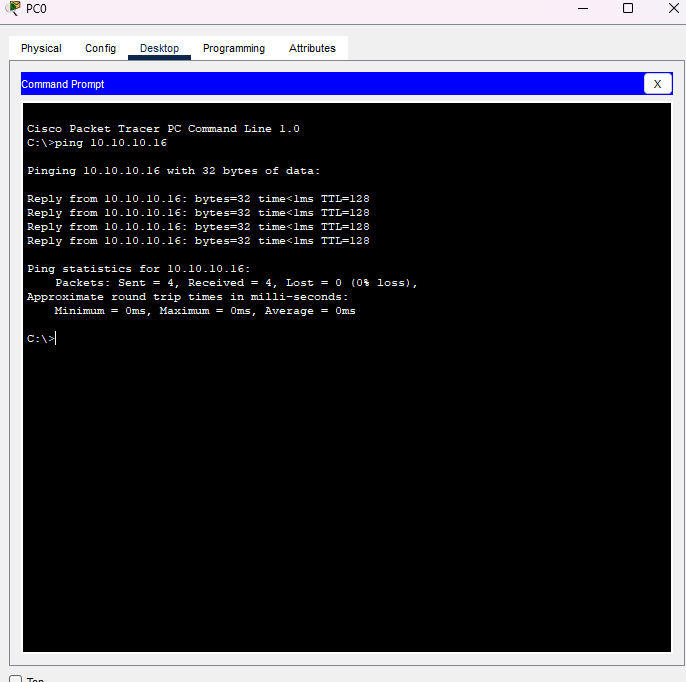
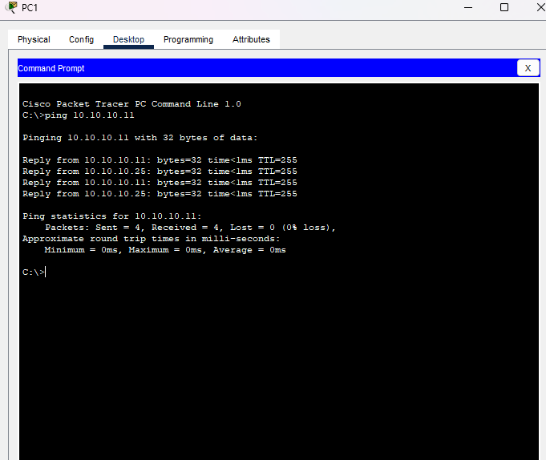

# Diagnóstico e correção de falhas de endereçamento e DHCP

> Laboratório 006 · mai/2025 · Evidência direta (captura de tela própria ou saída de terminal copiada na entrega)
>
> Página no portfólio: https://juli084.github.io/cybersecurity-portfolio/laboratorios/falhas-enderecamento-dhcp/

## Objetivo

Recebi uma rede de escritório que não funcionava e nenhuma pista do motivo. Levantei 13 dispositivos, encontrei falhas de rede, máscara, gateway, DNS, DHCP e cabeamento, e padronizei tudo em uma única sub-rede.

- Analisar a topologia em busca de falhas
- Documentar cada falha e a correção aplicada
- Deixar todas as estações se comunicando entre si, com o servidor e com o roteador

## Cenário

Diferente das atividades guiadas, aqui o enunciado só dizia para abrir a topologia, achar as falhas, corrigir e relatar, levando em conta a presença de um servidor DHCP.

## Ambiente

- Cisco Packet Tracer (rede simulada)

## Tecnologias

IPv4, DHCP, DNS, ICMP

## Ferramentas

Cisco Packet Tracer

## Procedimento

1. Passei por cada estação anotando interface, IP, máscara, gateway e DNS.
2. Agrupei as estações pelo tipo de erro para achar o padrão.
3. Verifiquei a configuração do roteador sem fio e do servidor DHCP.
4. Defini uma única rede, um gateway e uma faixa de DHCP, e reconfigurei roteador, servidor e estações.
5. Conferi o cabeamento no roteador e conectei o laptop que estava fora da rede.
6. Testei ping entre estações, para o servidor e para o roteador.

## Evidências

*Ping entre duas estações depois da correção.*

*Ping de uma estação para o gateway.*

## Análise técnica

As falhas se dividiam em quatro grupos:

| Grupo | O que encontrei | Efeito |
| --- | --- | --- |
| Rede e gateway | Parte das estações numa rede privada e parte em outra | Estações vizinhas não se enxergavam |
| Máscara e DNS | Máscara e servidor DNS incorretos em várias estações | Comunicação parcial e nomes sem resolver |
| Distribuição | Servidor DHCP sem configuração válida e roteador distribuindo outra faixa | Cada estação recebia o endereço de quem respondesse primeiro |
| Físico e acesso | Cabos em portas erradas no roteador, rede sem fio aberta, laptop desconectado | Enlaces inativos e rede sem proteção |

A decisão principal foi escolher uma rede só e fazer tudo obedecer a ela: mesma rede, mesma
máscara, um gateway, uma faixa de DHCP com 13 endereços para os 13 hosts.

Dois equipamentos distribuindo endereços diferentes na mesma rede explicam a maior parte do
sintoma. As estações não estavam "mal configuradas" uma a uma; elas estavam recebendo a
configuração de fontes que não concordavam entre si.

A rede sem fio aberta não impedia nada de funcionar, e por isso mesmo é o tipo de falha que passa
despercebida num chamado de conectividade. Anotei como falha de segurança, separada das de
funcionamento.

## Resultado

Todas as estações passaram a se comunicar entre si, com o servidor e com o roteador, na mesma sub-rede e com endereços distribuídos pelo DHCP.

## O que aprendi

Quando metade das máquinas está numa rede e metade em outra, o problema não está nas máquinas, está em quem distribui os endereços. Olhar o conjunto antes de corrigir uma por uma economiza tempo.

## Competências demonstradas

- `troubleshooting-de-redes`
- `enderecamento-ipv4`
- `dhcp`
- `documentacao-tecnica`

A relação entre competências e laboratórios está em [docs/skills-matrix.md](../../docs/skills-matrix.md).

## Frameworks relacionados

Relação com o que foi praticado. Não indica exercício profissional da função.

- **NICE Framework:** tarefas relacionadas às funções Network Operations, Technical Support

## Referências

- [RFC 2131: DHCP](https://www.rfc-editor.org/rfc/rfc2131)
- [RFC 1918: endereços privados](https://www.rfc-editor.org/rfc/rfc1918)

## Limitações

- Na tabela entregue, as colunas de falha e de correção têm o mesmo texto. Faltou registrar o valor errado e o valor corrigido de cada item.
- Não há captura da configuração do servidor DHCP depois do ajuste.

## Para reproduzir

- Cisco Packet Tracer. O cenário foi montado pelo docente e não está neste repositório.

## Considerações éticas

Atividade realizada em ambiente acadêmico, controlado e autorizado, com finalidade educacional. Veja [docs/ethics.md](../../docs/ethics.md).

---

*Arquivo gerado a partir de `lab.md` por `npm run readmes`. Edite o `lab.md`.*
