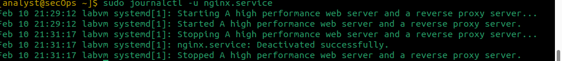

# Leitura, localização e monitoramento de logs no Linux

> Série de laboratórios 011 e 019 · set/2025 a nov/2025 · Evidência direta (captura de tela própria ou saída de terminal copiada na entrega)
>
> Página no portfólio: https://juli084.github.io/cybersecurity-portfolio/laboratorios/logs-linux/

## Objetivo

Dois laboratórios sobre o mesmo assunto: ler arquivos de log com as ferramentas de linha de comando, encontrar o log de um serviço desconhecido e acompanhar eventos em tempo real.

- Ler logs com cat, more, less e tail e saber quando usar cada um
- Entender a diferença entre syslog e journald
- Localizar o log de um serviço em um sistema que não conheço
- Acompanhar um log em tempo real enquanto gero eventos

## Cenário

Log é a primeira fonte de qualquer investigação e de qualquer chamado. Cada aplicação escreve do seu jeito, mas as ferramentas para ler são sempre as mesmas.

## Ambiente

- VM Linux de laboratório (VirtualBox)

## Tecnologias

HTTP, syslog

## Ferramentas

cat, more, less, tail, journalctl, grep, nginx

## Procedimento

1. Li o mesmo arquivo de log com cat, more e less e comparei o comportamento.
2. Usei tail e tail -f em dois terminais, gerando eventos em um e observando no outro.
3. Li um log restrito com privilégio de root e consultei o journal com journalctl.
4. Interpretei uma entrada de erro de servidor web campo por campo.
5. Procurei, em um log de sistema, evidência de uma lentidão relatada num horário específico.
6. Localizei o serviço nginx com ps e grep e segui o log dele com journalctl -u.

## Evidências

*Histórico do serviço nginx no journal, com início, parada e encerramento registrados pelo systemd.*

## Análise técnica

## Qual ferramenta para qual situação

| Ferramenta | Serve para | Limite |
| --- | --- | --- |
| `cat` | Arquivo pequeno, ou para encadear com outro comando | Despeja tudo de uma vez; em arquivo grande, o início some da tela |
| `more` | Ler página por página | Navegação limitada |
| `less` | Ler, voltar e buscar dentro do arquivo | Não acompanha novas linhas por padrão |
| `tail` | Ver o fim do arquivo | Mostra só o estado no momento |
| `tail -f` | Acompanhar o que está sendo escrito agora | Precisa de outro terminal para gerar o evento |

## Syslog e journald

O syslog grava texto simples, legível com qualquer ferramenta e fácil de enviar a um servidor
remoto. O journald guarda em formato binário estruturado, o que permite filtrar por serviço, por
período ou por prioridade com `journalctl`, mas exige essa ferramenta para ler. Ver o journal
completo requer root ou participação em um grupo específico, o que por si só já é um controle de
acesso ao histórico da máquina.

## Lendo uma entrada

Uma linha de erro de servidor web traz horário, tipo do evento, processo, endereço do cliente e
descrição. No exemplo analisado, um cliente pediu um arquivo que não existia e o servidor registrou
o erro. Isolada, a linha é irrelevante. Centenas iguais, do mesmo endereço e em sequência, são
varredura.

## A lentidão

O chamado dizia que a rede ficou lenta em um horário específico. No log do sistema, naquele
intervalo, a interface de rede alternava entre ativa e inativa várias vezes. É a oscilação de
enlace, que na prática costuma ser cabo, porta de switch ou placa. O log não diz qual dos três, mas
diz onde procurar.

## Resultado

Arquivos lidos com as quatro ferramentas, log do serviço localizado e acompanhado em tempo real, e a causa provável da lentidão identificada nas mensagens do sistema.

## O que aprendi

Horário errado inutiliza log. Sem relógio sincronizado não dá para cruzar o que um servidor registrou com o que outro registrou. E tail -f em um terminal enquanto se testa em outro é o jeito mais direto de ver causa e efeito.

## Competências demonstradas

- `leitura-de-logs`
- `linux-cli`
- `servicos-linux`

A relação entre competências e laboratórios está em [docs/skills-matrix.md](../../docs/skills-matrix.md).

## Frameworks relacionados

Relação com o que foi praticado. Não indica exercício profissional da função.

- **NIST CSF 2.0:** DE.CM (Continuous Monitoring); DE.AE (Adverse Event Analysis)
- **NICE Framework:** tarefas relacionadas às funções Defensive Cybersecurity, Systems Administration

## Referências

- [journalctl: página de manual](https://www.freedesktop.org/software/systemd/man/latest/journalctl.html)
- [RFC 5424: protocolo syslog](https://www.rfc-editor.org/rfc/rfc5424)
- [nginx: configuração de logs](https://nginx.org/en/docs/ngx_core_module.html#error_log)

## Limitações

- O laboratório 011 não tem captura de tela; ficou o registro escrito das respostas.
- Só uma captura do 019 foi guardada.

## Para reproduzir

- Qualquer distribuição Linux com systemd e um serviço web instalado.
- Comandos centrais: tail -f, journalctl -u e ps com grep.

## Considerações éticas

Atividade realizada em ambiente acadêmico, controlado e autorizado, com finalidade educacional. Veja [docs/ethics.md](../../docs/ethics.md).

---

*Arquivo gerado a partir de `lab.md` por `npm run readmes`. Edite o `lab.md`.*
