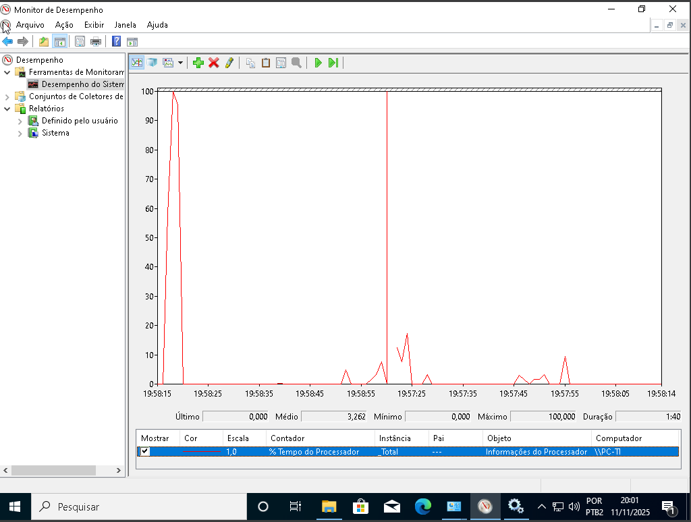
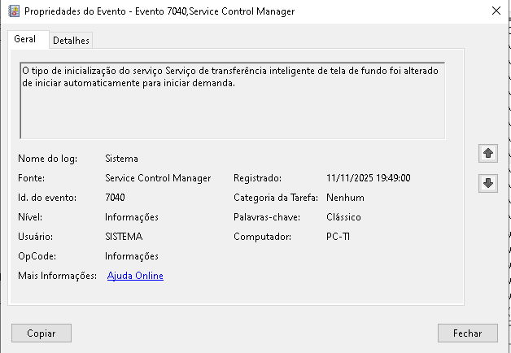
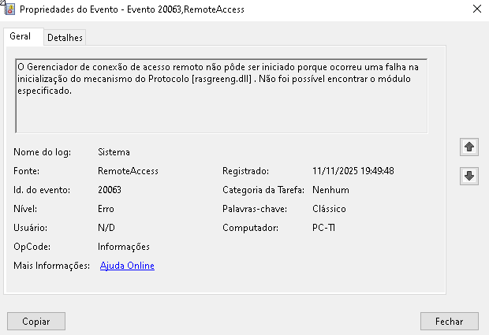
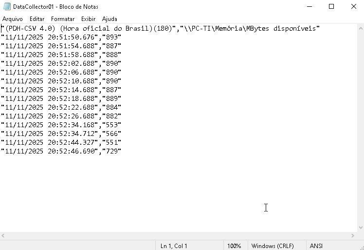

# Monitoramento de serviços, eventos e desempenho no Windows

> Laboratório 021 · nov/2025 · Evidência direta (captura de tela própria ou saída de terminal copiada na entrega)
>
> Página no portfólio: https://juli084.github.io/cybersecurity-portfolio/laboratorios/monitoramento-windows/

## Objetivo

Iniciei e parei um serviço do Windows observando o efeito no sistema, li os eventos gerados e criei um coletor de dados que grava a memória disponível em arquivo.

- Iniciar e parar um serviço e observar o efeito
- Ler os eventos registrados pelo sistema
- Registrar um contador de desempenho e gravar uma coleta em arquivo

## Cenário

As ferramentas administrativas do Windows mostram o que mudou na máquina e quando. É o mesmo raciocínio de log do Linux, com outra interface.

## Ambiente

- VM Windows 10 (VirtualBox)

## Ferramentas

Monitor de Desempenho, Visualizador de Eventos, Serviços do Windows

## Procedimento

1. Abri as conexões de rede e o Monitor de Desempenho lado a lado.
2. Em Serviços, mudei o tipo de inicialização do Roteamento e Acesso Remoto e iniciei o serviço.
3. Observei a nova conexão que apareceu e o gráfico do processador durante a mudança.
4. Parei o serviço e conferi que a conexão sumiu.
5. No Visualizador de Eventos, li os eventos gerados pelas mudanças.
6. Criei um conjunto de coletores com o contador de memória disponível, gravei alguns minutos e abri o CSV.

## Evidências

*Contador de tempo do processador durante a atividade, com picos nos momentos de mudança.*

*Evento 7040 do Service Control Manager. O sistema registra toda mudança de tipo de inicialização de serviço.*

*Evento 20063, de erro, gerado pelo serviço de acesso remoto ao tentar iniciar.*

*Arquivo gerado pelo coletor, com a memória disponível amostrada em intervalos regulares.*

## Análise técnica

## O serviço

Com o Roteamento e Acesso Remoto parado, a máquina tinha uma conexão de rede. Ao iniciá-lo, surgiu
uma segunda, de conexões de entrada, sem clientes. Ao pará-lo, ela sumiu. Um serviço que ninguém
pediu, rodando, é uma porta a mais na máquina, e a lista de conexões mostra isso sem precisar de
ferramenta externa.

## Os eventos

Cada ação gerou registro no log do sistema:

| Evento | Origem | O que diz |
| --- | --- | --- |
| 7040 | Service Control Manager | O tipo de inicialização de um serviço foi alterado |
| 20063 | RemoteAccess | O serviço falhou ao inicializar um componente |

O 7040 interessa a quem administra e a quem investiga: é o registro de que alguém mudou como um
serviço se comporta na inicialização. Ver esse evento fora de uma janela de manutenção merece
pergunta.

## A coleta

O coletor gravou a memória disponível em megabytes, a cada poucos segundos, num CSV. Durante a
coleta os valores caíram de cerca de 890 MB para a faixa de 550 MB. A utilidade está na série, não
no número isolado: sem linha de base não há como dizer se um valor é anormal.

## Resultado

Serviço iniciado e parado com o efeito observado nas conexões de rede, eventos correspondentes localizados e coleta de memória gravada em CSV.

## O que aprendi

Uma mudança de configuração deixa rastro em mais de um lugar: na lista de conexões, no gráfico e no log de eventos. Cruzar os três é mais confiável do que olhar um só.

## Competências demonstradas

- `monitoramento-windows`
- `leitura-de-logs`

A relação entre competências e laboratórios está em [docs/skills-matrix.md](../../docs/skills-matrix.md).

## Frameworks relacionados

Relação com o que foi praticado. Não indica exercício profissional da função.

- **NIST CSF 2.0:** DE.CM (Continuous Monitoring)
- **NICE Framework:** tarefas relacionadas às funções Systems Administration

## Referências

- [Microsoft: perfmon](https://learn.microsoft.com/windows-server/administration/windows-commands/perfmon)
- [Microsoft: registro de eventos](https://learn.microsoft.com/windows/win32/eventlog/event-logging)

## Limitações

- A entrega mistura capturas minhas, em português, com ilustrações do roteiro, em inglês. Aqui estão só as minhas.
- Duas perguntas foram respondidas apenas com imagem, sem texto.

## Para reproduzir

- Windows 10 em máquina virtual.
- Ferramentas: services.msc, perfmon e eventvwr.

## Considerações éticas

Atividade realizada em ambiente acadêmico, controlado e autorizado, com finalidade educacional. Veja [docs/ethics.md](../../docs/ethics.md).

---

*Arquivo gerado a partir de `lab.md` por `npm run readmes`. Edite o `lab.md`.*
