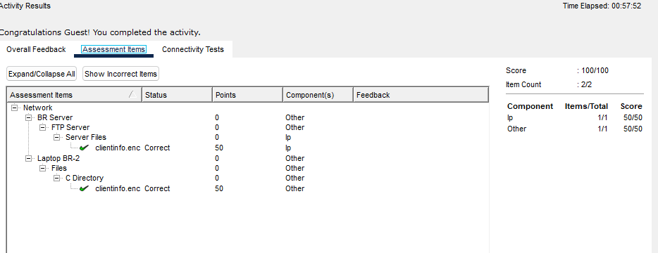

# Integridade e confidencialidade de arquivos: hash, HMAC e arquivo cifrado em trânsito

> Série de laboratórios 024 e 025 · nov/2025 a dez/2025 · Evidência direta (captura de tela própria ou saída de terminal copiada na entrega)
>
> Página no portfólio: https://juli084.github.io/cybersecurity-portfolio/laboratorios/integridade-criptografia-arquivos/

## Objetivo

Duas atividades complementares: verificar se arquivos foram alterados comparando hashes e HMAC, e transferir um arquivo cifrado por um canal que não protege nada.

- Comparar hashes para identificar arquivos modificados
- Calcular e verificar um HMAC e entender o que ele acrescenta ao hash
- Enviar e receber um arquivo cifrado por FTP e decifrá-lo no destino
- Decifrar uma mensagem com OpenSSL na linha de comando

## Cenário

Integridade responde se o arquivo é o mesmo que foi gravado. Confidencialidade responde quem consegue ler. São perguntas diferentes, com ferramentas diferentes, e as duas atividades tratam uma de cada.

## Ambiente

- Cisco Packet Tracer (rede simulada)
- VM Linux de laboratório (VirtualBox)

## Tecnologias

FTP, AES-256, MD5, HMAC

## Ferramentas

Cisco Packet Tracer, OpenSSL

## Procedimento

1. 024: recuperei arquivos em estações de regiões diferentes e comparei o hash de cada um com o valor de referência.
2. 024: identifiquei os arquivos cujo hash não batia e calculei o HMAC de um arquivo para verificação com chave.
3. 025: localizei as credenciais da conta de transferência, enviei o arquivo cifrado ao servidor e o baixei em outra estação.
4. 025: decifrei o arquivo no destino com a chave combinada.
5. 025: no desafio final, decifrei um texto em Base64 com openssl aes-256-cbc usando derivação de chave PBKDF2.

## Evidências

*025: atividade concluída com 100 de 100. Os itens avaliados são a presença do arquivo cifrado no servidor e na estação de destino.*

## Análise técnica

## Hash contra HMAC

| | Hash | HMAC |
| --- | --- | --- |
| Entrada | O arquivo | O arquivo e uma chave secreta |
| Detecta alteração acidental | Sim | Sim |
| Detecta alteração por quem controla o arquivo | Não: basta recalcular | Sim: sem a chave, o valor não fecha |
| Garante | Integridade | Integridade e autenticidade |

Na atividade, o primeiro arquivo conferido tinha o hash igual ao de referência. Seguindo pelos
demais, apareceram valores divergentes, que marcam os arquivos a enviar para análise. A ferramenta
não diz o que mudou, só que mudou, e isso basta para a triagem.

O algoritmo usado no cenário para o hash simples foi o MD5. Para verificação de integridade contra
erro ele ainda cumpre o papel, mas não resiste a colisão proposital. Em uso real, a escolha é
SHA-256 ou superior.

## O que o FTP expõe

O arquivo viajou cifrado com AES-256. Se alguém capturasse a transferência, não leria o conteúdo.
Leria, porém, o usuário e a senha da conta, que o FTP envia em texto claro, e com isso poderia
baixar o próprio arquivo cifrado e qualquer outro.

A proteção do conteúdo depende então de a chave de decifragem não circular pelo mesmo canal. Em
produção, a transferência seria por SFTP ou FTPS, e a chave iria por outro meio.

## O desafio com OpenSSL

O texto vinha em Base64 e tinha sido cifrado com AES-256 em modo CBC, com a chave derivada de uma
senha por PBKDF2. Os três parâmetros precisam ser os mesmos na cifragem e na decifragem: algoritmo,
codificação e forma de derivar a chave. Errar qualquer um devolve erro ou texto ilegível.

## Resultado

Arquivos alterados identificados pela divergência de hash, HMAC calculado e conferido, arquivo cifrado transferido e decifrado no destino, e a mensagem do desafio recuperada com OpenSSL.

## O que aprendi

Cifrar o arquivo não protege a sessão. No FTP, usuário e senha continuam em texto claro mesmo que o conteúdo vá cifrado. E um hash sozinho só detecta alteração acidental: quem altera o arquivo também pode recalcular o hash. O HMAC fecha essa brecha porque depende de uma chave.

## Competências demonstradas

- `hash-e-integridade`
- `criptografia-simetrica`

A relação entre competências e laboratórios está em [docs/skills-matrix.md](../../docs/skills-matrix.md).

## Frameworks relacionados

Relação com o que foi praticado. Não indica exercício profissional da função.

- **NIST CSF 2.0:** PR.DS (Data Security)
- **NICE Framework:** tarefas relacionadas às funções Systems Security Analysis

## Referências

- [RFC 2104: HMAC](https://www.rfc-editor.org/rfc/rfc2104)
- [OpenSSL: comando enc](https://docs.openssl.org/master/man1/openssl-enc/)
- [RFC 959: FTP](https://www.rfc-editor.org/rfc/rfc959)

## Limitações

- A 024 não tem captura de tela nem os comandos usados; ficaram os valores de hash anotados.
- Na 024, a pergunta sobre qual arquivo foi modificado foi respondida com quatro nomes, sem distinguir qual era o caso pedido.
- As credenciais, as chaves e os dados fictícios de clientes do cenário não são reproduzidos aqui.

## Para reproduzir

- Cisco Packet Tracer com as atividades do Cisco Networking Academy e uma VM Linux com OpenSSL.
- Para decifrar texto em Base64: openssl aes-256-cbc -pbkdf2 -a -d.

## Considerações éticas

Atividade realizada em ambiente acadêmico, controlado e autorizado, com finalidade educacional. Veja [docs/ethics.md](../../docs/ethics.md).

---

*Arquivo gerado a partir de `lab.md` por `npm run readmes`. Edite o `lab.md`.*
