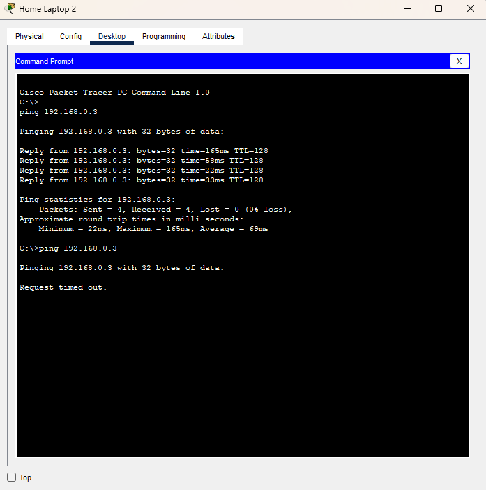
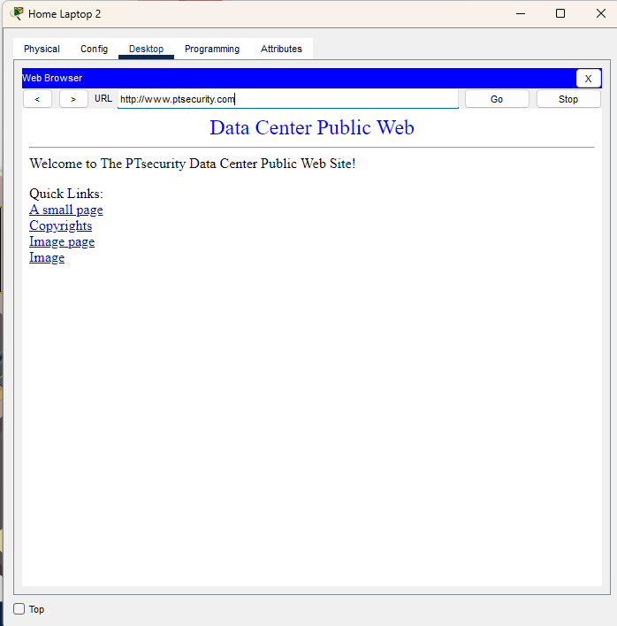
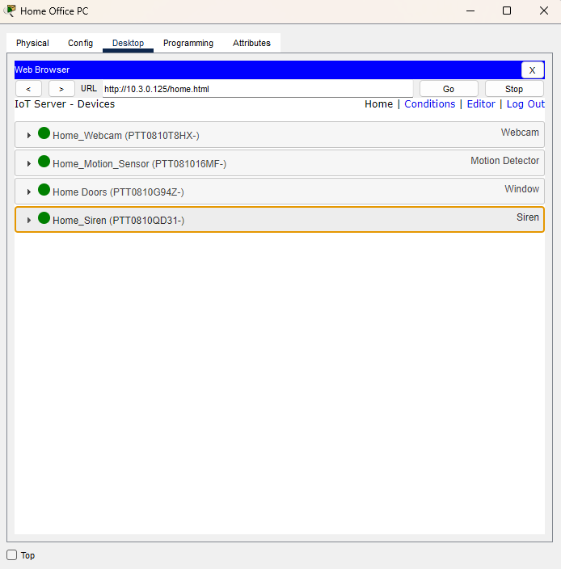
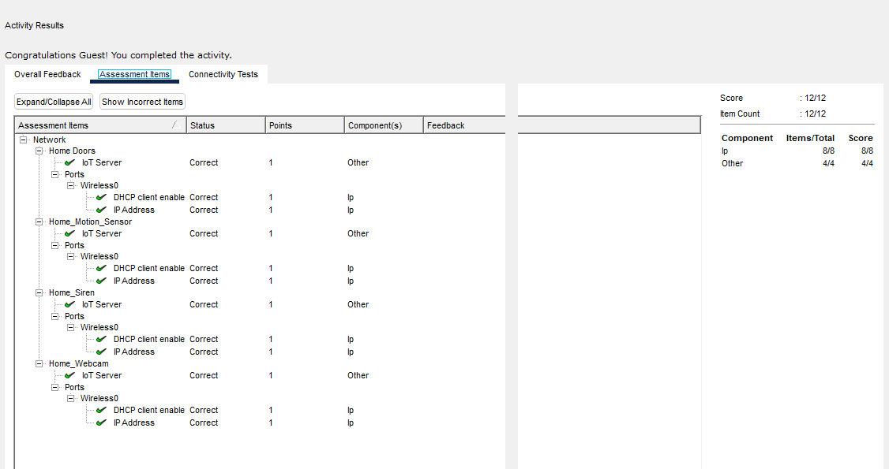

# Hardening de roteador sem fio e dispositivos IoT em rede doméstica

> Série de laboratórios 027 e 028 · fev/2026 · Evidência direta (captura de tela própria ou saída de terminal copiada na entrega)
>
> Página no portfólio: https://juli084.github.io/cybersecurity-portfolio/laboratorios/wifi-iot-hardening/

## Objetivo

Corrigi a configuração de um roteador sem fio que tinha sido instalado pela metade, separei a rede de convidados da rede interna e conectei dispositivos IoT de segurança física a um servidor de registro.

- Trocar a senha de administração e desativar o gerenciamento remoto
- Configurar SSID e WPA2 nas redes interna e de convidados
- Conectar clientes e dispositivos IoT com a configuração nova
- Verificar conectividade e o isolamento entre as redes

## Cenário

Roteador doméstico sai de fábrica pronto para funcionar, não para ser seguro. Senha de administração padrão e gerenciamento remoto ligado são as duas primeiras coisas que um invasor testa.

## Ambiente

- Cisco Packet Tracer (rede simulada)

## Tecnologias

WPA2, DHCP, ICMP, HTTP

## Ferramentas

Cisco Packet Tracer

## Procedimento

1. 027: entrei na administração do roteador, troquei a senha padrão e desativei o gerenciamento remoto.
2. 027: habilitei a transmissão do SSID, defini os nomes das redes e configurei WPA2 na rede interna e na de convidados.
3. 027: reconectei laptops e dispositivos IoT com os novos parâmetros.
4. 027: testei ping entre equipamentos e acesso a um site externo.
5. 028: conectei sirene, sensores de porta e de movimento e câmera à rede sem fio e registrei cada um no servidor IoT.
6. 028: acionei os dispositivos e conferi o estado de cada um no painel do servidor.

## Evidências

*027: dois testes de ping a partir de um laptop sem fio durante a verificação, um com resposta e outro expirando.*

*027: o laptop acessa um site externo depois da reconfiguração, o que confirma associação, endereço, gateway e DNS.*

*028: os quatro dispositivos registrados e ativos no servidor IoT.*

*028: atividade concluída, 12 de 12 itens.*

## Análise técnica

| Ajuste | Risco que reduz |
| --- | --- |
| Trocar a senha de administração | Credencial de fábrica é pública; com ela qualquer pessoa na rede reconfigura o roteador |
| Desativar o gerenciamento remoto | A administração deixa de estar acessível a partir da internet |
| WPA2 nas duas redes | Só entra quem tem a chave, e o tráfego sem fio vai cifrado |
| Rede de convidados separada | Visitante usa a internet sem alcançar os equipamentos da casa |

O gerenciamento remoto existe para a operadora dar suporte. Se for mesmo necessário, o caminho
seguro é uma VPN. O equipamento do cenário não oferecia essa opção, então a decisão foi desligar.

## IoT

Câmera, sensor de movimento, sensores de porta e sirene dependem da mesma rede sem fio e de um
servidor que centraliza o registro. Isso tem duas consequências. Se a rede cai, a segurança física
cai junto. E quem compromete o servidor passa a ver e a controlar tudo.

Alguns dispositivos só enviam informação, como o sensor de movimento. Outros aceitam comando, como a
câmera, que pode ser desligada pelo painel. Os que aceitam comando são os que mais precisam de
controle de acesso.

## Resultado

Roteador com senha de administração própria, gerenciamento remoto desligado e as duas redes com WPA2. As duas atividades fecharam em 100%.

## O que aprendi

Esconder o SSID não é medida de segurança: o nome da rede aparece no tráfego de qualquer cliente que se conecta. O que protege é a chave e a separação entre redes. E cada dispositivo IoT ligado à rede interna é mais um equipamento que precisa de senha própria e de atualização.

## Competências demonstradas

- `hardening-de-roteador`
- `wifi-wpa2`

A relação entre competências e laboratórios está em [docs/skills-matrix.md](../../docs/skills-matrix.md).

## Frameworks relacionados

Relação com o que foi praticado. Não indica exercício profissional da função.

- **NIST CSF 2.0:** PR.AA (Identity Management, Authentication, and Access Control); PR.PS (Platform Security); PR.IR (Technology Infrastructure Resilience)
- **NICE Framework:** tarefas relacionadas às funções Infrastructure Support, Network Operations

## Referências

- [CISA: protegendo redes sem fio](https://www.cisa.gov/news-events/news/securing-wireless-networks)
- [Wi-Fi Alliance: segurança](https://www.wi-fi.org/discover-wi-fi/security)

## Limitações

- A entrega não tem texto meu explicando cada ajuste; a análise abaixo foi escrita para este portfólio.
- As senhas e chaves usadas são as do roteiro e não são reproduzidas aqui.
- Na 028 não avaliei o risco dos dispositivos em si, apenas a conexão e o registro.

## Para reproduzir

- Cisco Packet Tracer e as atividades correspondentes do Cisco Networking Academy.

## Considerações éticas

Atividade realizada em ambiente acadêmico, controlado e autorizado, com finalidade educacional. Veja [docs/ethics.md](../../docs/ethics.md).

---

*Arquivo gerado a partir de `lab.md` por `npm run readmes`. Edite o `lab.md`.*
