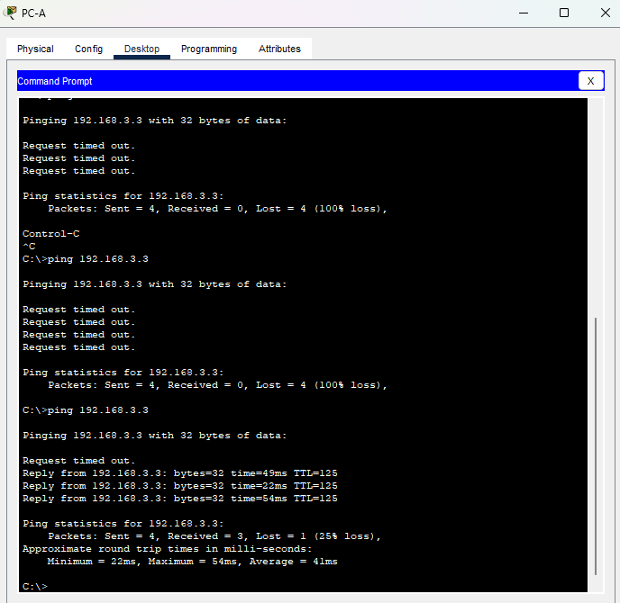
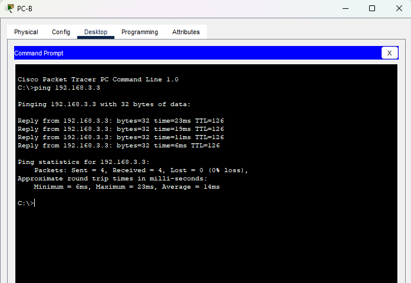
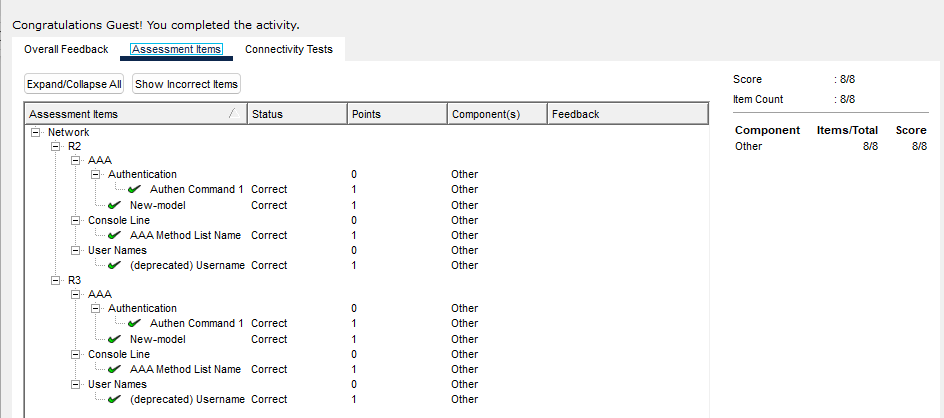

# Correção de falhas e autenticação AAA com TACACS+ e RADIUS

> Avaliação prática 029 · mar/2026 · Evidência direta (captura de tela própria ou saída de terminal copiada na entrega)
>
> Página no portfólio: https://juli084.github.io/cybersecurity-portfolio/laboratorios/aaa-tacacs-radius/

## Objetivo

Avaliação prática: uma rede com três roteadores e várias falhas. Encontrei e corrigi dez delas e deixei dois roteadores autenticando administradores em servidor, um com TACACS+ e outro com RADIUS.

- Analisar a rede, encontrar e corrigir as falhas
- Configurar autenticação AAA baseada em servidor com TACACS+
- Configurar autenticação AAA baseada em servidor com RADIUS
- Verificar a conectividade e a autenticação

## Cenário

O cenário era um chamado depois de um acesso não autorizado. Todo o acesso administrativo aos roteadores dependia de uma única senha local. A tarefa era achar o que estava quebrado, corrigir e centralizar a autenticação em servidores.

## Ambiente

- Cisco Packet Tracer (rede simulada)

## Tecnologias

TACACS+, RADIUS, IPv4, ICMP

## Ferramentas

Cisco Packet Tracer, Cisco IOS

## Procedimento

1. Testei a conectividade entre as três redes para localizar onde ela parava.
2. Corrigi o endereçamento da estação que estava fora da rede.
3. Em cada roteador, conferi se o AAA estava habilitado, se o servidor estava declarado e se o método estava aplicado nas linhas de console e vty.
4. Conferi no servidor se o roteador estava cadastrado como cliente e se a chave compartilhada coincidia.
5. Repeti os testes de ping entre as redes e verifiquei a pontuação da atividade.

## Evidências

*O mesmo ping antes e depois da correção de endereçamento. As duas primeiras tentativas perdem tudo; a terceira responde.*

*Conectividade entre as redes confirmada a partir de outra estação.*

*Pontuação 8 de 8. Os itens avaliados são o AAA, o método de autenticação, as linhas de console e os usuários em cada roteador.*

## Análise técnica

A tabela que entreguei, sem os endereços e as chaves:

| # | Onde | O que estava errado | O que eu fiz |
| --- | --- | --- | --- |
| 1 | Estação | Gateway padrão incorreto | Ajustei para o roteador da rede |
| 2 | Estação | Endereço IP fora da rede | Ajustei para a faixa correta |
| 3 | Roteador 2 | Servidor TACACS+ não configurado | Declarei o servidor |
| 4 | Roteador 3 | Servidor RADIUS não configurado | Declarei o servidor |
| 5 | Roteador 2 | AAA desabilitado | `aaa new-model` |
| 6 | Roteador 3 | AAA desabilitado | `aaa new-model` |
| 7 | Roteador 2 | Autenticação TACACS+ fora das linhas | Apliquei o método em console e vty |
| 8 | Roteador 3 | Autenticação RADIUS fora das linhas | Apliquei o método em console e vty |
| 9 | Servidor TACACS+ | Roteador não autenticava | Configurei a chave compartilhada |
| 10 | Servidor RADIUS | Roteador não autenticava | Configurei a chave compartilhada |

## Três grupos de falha

**Rede (1 e 2).** Com IP e gateway errados, a estação nem alcançava os servidores. Nada de AAA
funciona antes disso.

**Configuração de AAA no roteador (3 a 8).** Sem `aaa new-model`, sem o servidor declarado ou sem o
método aplicado nas linhas, o roteador simplesmente continua usando a senha local.

**Confiança entre as partes (9 e 10).** Roteador e servidor só conversam se a chave compartilhada
for a mesma dos dois lados.

## TACACS+ e RADIUS

Os dois centralizam autenticação, autorização e registro. O TACACS+ usa TCP, cifra o corpo inteiro
do pacote e trata as três funções separadamente, o que permite autorizar comando por comando. Por
isso é o mais usado para administração de equipamentos. O RADIUS usa UDP, cifra só a senha e junta
autenticação com autorização. É o padrão para acesso de usuários à rede, como Wi-Fi corporativo e
VPN.

## Por que centralizar

Com senha local, todos os administradores compartilham a mesma credencial, não há registro de quem
fez o quê, e a saída de uma pessoa obriga a trocar a senha em todos os equipamentos. Com servidor,
cada um tem a sua conta, o acesso é revogado num lugar só e cada sessão fica registrada.

## Resultado

Dez falhas documentadas e corrigidas, conectividade entre as três redes restabelecida e autenticação por servidor funcionando nos dois roteadores. Pontuação 8 de 8.

## O que aprendi

As falhas formavam uma cadeia. Sem rede a estação não chega ao servidor, sem o AAA habilitado o roteador não pergunta nada ao servidor, e sem a chave igual dos dois lados o servidor não responde. Corrigir fora dessa ordem dá a impressão de que nada adiantou.

## Competências demonstradas

- `aaa-tacacs-radius`
- `troubleshooting-de-redes`
- `documentacao-tecnica`

A relação entre competências e laboratórios está em [docs/skills-matrix.md](../../docs/skills-matrix.md).

## Frameworks relacionados

Relação com o que foi praticado. Não indica exercício profissional da função.

- **NIST CSF 2.0:** PR.AA (Identity Management, Authentication, and Access Control)
- **NICE Framework:** tarefas relacionadas às funções Network Operations, Infrastructure Support

## Referências

- [RFC 8907: protocolo TACACS+](https://www.rfc-editor.org/rfc/rfc8907)
- [RFC 2865: RADIUS](https://www.rfc-editor.org/rfc/rfc2865)

## Limitações

- A entrega tem a tabela de falhas, mas não os comandos usados em cada correção.
- Não há captura do login de teste nos roteadores, só dos pings e da pontuação.
- Não configurei um método local de reserva. Se o servidor AAA ficasse fora do ar, o acesso administrativo ficaria travado.

## Para reproduzir

- Cisco Packet Tracer. O cenário com as falhas foi preparado pelo docente e não está neste repositório.

## Considerações éticas

Atividade realizada em ambiente acadêmico, controlado e autorizado, com finalidade educacional. Veja [docs/ethics.md](../../docs/ethics.md).

---

*Arquivo gerado a partir de `lab.md` por `npm run readmes`. Edite o `lab.md`.*
