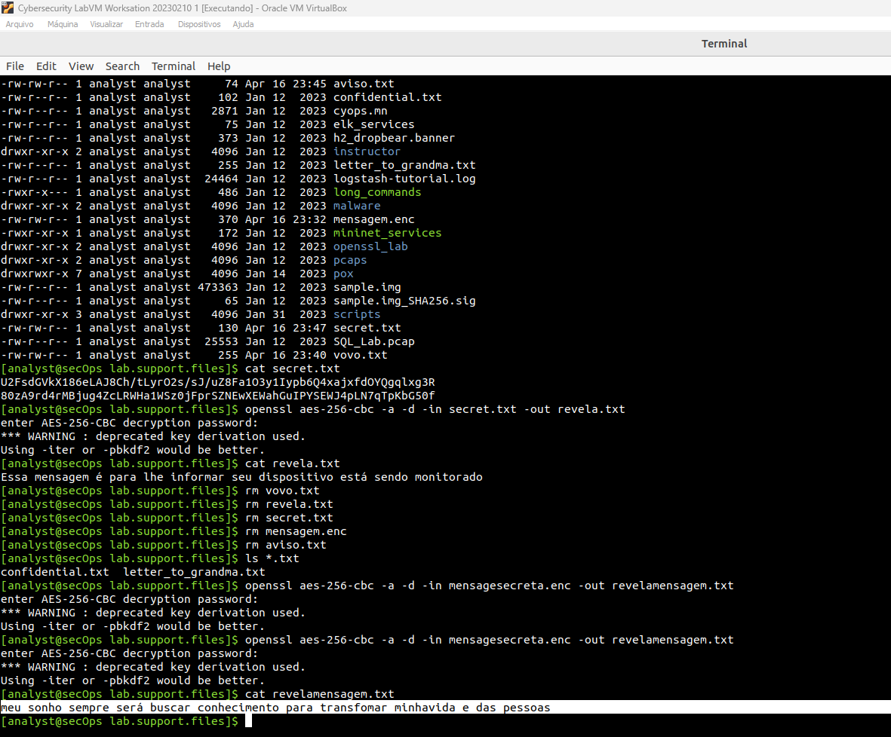

# Decifragem AES-256-CBC com OpenSSL na linha de comando

> Laboratório 038 · abr/2026 · Evidência direta (captura de tela própria ou saída de terminal copiada na entrega)
>
> Página no portfólio: https://juli084.github.io/cybersecurity-portfolio/laboratorios/openssl-aes/

## Objetivo

Recebi um arquivo cifrado, o algoritmo e a senha. Decifrei com OpenSSL no terminal e li a mensagem. O aviso que o OpenSSL emitiu no caminho acabou sendo a parte mais instrutiva.

- Decifrar o arquivo com OpenSSL
- Entregar a mensagem em claro

## Cenário

Desafio curto proposto em aula: um arquivo com extensão .enc, a informação de que foi cifrado com AES-256 em modo CBC e a senha. Nada de roteiro.

## Ambiente

- VM Linux de laboratório (VirtualBox)

## Tecnologias

AES-256-CBC, Base64

## Ferramentas

OpenSSL

## Procedimento

1. Antes do arquivo do desafio, decifrei outro arquivo cifrado, de exemplo, para confirmar os parâmetros.
2. Rodei openssl aes-256-cbc com -a para Base64 e -d para decifrar, indicando arquivo de entrada e de saída.
3. Digitei a senha quando solicitada.
4. Li o arquivo de saída com cat.

## Evidências



*Sessão completa no terminal. Aparecem o teste inicial, o comando de decifragem, o aviso do OpenSSL sobre derivação de chave e a mensagem em claro ao final.*

## Análise técnica

O comando tem quatro partes que precisam coincidir com a forma como o arquivo foi cifrado:

| Parte | O que significa |
| --- | --- |
| `aes-256-cbc` | Algoritmo AES, chave de 256 bits, modo de encadeamento de blocos |
| `-a` | O arquivo está em Base64, texto, e não em binário |
| `-d` | Decifrar |
| senha | De onde a chave é derivada |

O arquivo começava com `U2FsdGVkX1`, que é a palavra "Salted__" em Base64. É a marca do formato do
OpenSSL quando a chave vem de senha: logo depois dela fica o sal usado na derivação.

## O aviso

```text
*** WARNING : deprecated key derivation used.
Using -iter or -pbkdf2 would be better.
```

Senha não é chave. O OpenSSL transforma uma em outra com uma função de derivação. A antiga faz essa
conta uma única vez, o que deixa barato testar milhões de senhas contra o arquivo. O PBKDF2 repete
a operação milhares de vezes, e cada tentativa de adivinhação fica proporcionalmente mais cara.

A força do AES-256 não muda. O que muda é o elo mais fraco, que passa a ser a senha e a forma de
derivar a chave. Um arquivo cifrado com AES-256 e uma senha curta, sem PBKDF2, é mais frágil do que
o nome do algoritmo sugere.

## Por que testar antes

Decifrei primeiro um arquivo de exemplo. Se a decifragem do desafio falhasse depois, eu saberia que
o problema estava na senha ou no arquivo, e não na minha sintaxe.

## Resultado

Arquivo decifrado e mensagem lida. O arquivo cifrado e o resultado estão guardados junto com a captura.

## O que aprendi

O OpenSSL avisou que a derivação de chave usada era obsoleta e sugeriu -iter ou -pbkdf2. O arquivo tinha sido cifrado do jeito antigo, então precisei decifrar do mesmo jeito. Para cifrar algo meu, usaria -pbkdf2.

## Competências demonstradas

- `criptografia-simetrica`
- `linux-cli`

A relação entre competências e laboratórios está em [docs/skills-matrix.md](../../docs/skills-matrix.md).

## Frameworks relacionados

Relação com o que foi praticado. Não indica exercício profissional da função.

- **NIST CSF 2.0:** PR.DS (Data Security)

## Referências

- [OpenSSL: comando enc](https://docs.openssl.org/master/man1/openssl-enc/)
- [RFC 8018: PBKDF2 (PKCS #5)](https://www.rfc-editor.org/rfc/rfc8018)
- [NIST SP 800-38A: modos de operação](https://csrc.nist.gov/pubs/sp/800/38/a/final)

## Limitações

- A entrega foi só o arquivo decifrado e a captura, sem texto.
- A senha do desafio foi definida pelo docente e não é reproduzida aqui.

## Para reproduzir

- Decifrar: openssl aes-256-cbc -a -d -in arquivo.enc -out saida.txt
- Cifrar com derivação atual: openssl aes-256-cbc -pbkdf2 -a -in entrada.txt -out arquivo.enc

## Considerações éticas

Atividade realizada em ambiente acadêmico, controlado e autorizado, com finalidade educacional. Veja [docs/ethics.md](../../docs/ethics.md).

---

*Arquivo gerado a partir de `lab.md` por `npm run readmes`. Edite o `lab.md`.*
