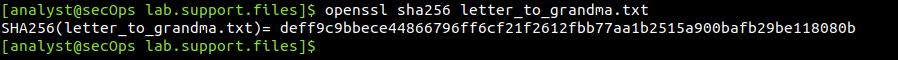
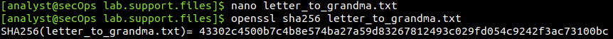
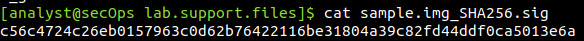
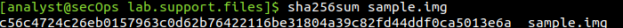

# Cálculo e verificação de hashes com OpenSSL

> Laboratório 041 · mai/2026 · Evidência direta (captura de tela própria ou saída de terminal copiada na entrega)
>
> Página no portfólio: https://juli084.github.io/cybersecurity-portfolio/laboratorios/hashes-openssl/

## Objetivo

Calculei o hash de um arquivo, alterei uma única letra e calculei de novo. Depois usei o mesmo princípio para verificar a integridade de um download contra o hash publicado.

- Gerar o hash de um arquivo de texto com OpenSSL
- Observar o efeito de uma alteração mínima no arquivo
- Verificar a integridade de um arquivo baixado

## Cenário

Função de hash recebe qualquer quantidade de dados e devolve uma sequência de tamanho fixo. É rápida de calcular, impraticável de reverter, e qualquer alteração na entrada muda o resultado inteiro. Essa última propriedade é o que a torna útil para verificar integridade.

## Ambiente

- VM Linux de laboratório (VirtualBox)

## Tecnologias

SHA-256, SHA-512

## Ferramentas

OpenSSL, sha256sum, sha512sum, nano

## Procedimento

1. Calculei o SHA-256 de um arquivo de texto com openssl sha256.
2. Abri o arquivo no nano, troquei uma letra, salvei e calculei de novo.
3. Calculei também o SHA-512 e repeti os dois cálculos com sha256sum e sha512sum.
4. Li o hash publicado junto com um arquivo de imagem e calculei o hash do arquivo baixado.
5. Comparei os dois valores.

## Evidências

*Hash SHA-256 do arquivo original.*

*Depois de trocar uma letra, o hash não tem nenhum trecho em comum com o anterior.*

*Hash publicado pelo distribuidor do arquivo.*

*Hash calculado localmente. Os dois valores são idênticos.*

## Análise técnica

## Uma letra

O arquivo começava com uma saudação, e troquei uma única letra em uma palavra. Os dois hashes estão
nas duas primeiras capturas: um começa com `deff9c` e o outro com `43302c`, e não há trecho em comum
entre eles. É o efeito avalanche: uma mudança mínima na entrada altera, em média, metade
dos bits da saída. Por isso não dá para ajustar o arquivo aos poucos até o hash coincidir.

## Duas ferramentas, mesmo resultado

`openssl sha256` e `sha256sum` devolveram o mesmo valor para o mesmo arquivo, e o mesmo ocorreu com
SHA-512. O algoritmo é um padrão público; a ferramenta só o implementa. Se duas ferramentas
discordarem, uma delas leu um arquivo diferente.

## Verificando um download

As duas últimas capturas mostram o hash publicado e o hash que calculei sobre o arquivo baixado. Os
valores são iguais, então o arquivo que tenho é o mesmo que foi publicado.

O limite dessa verificação é a origem do hash. Se ele vem do mesmo servidor que o arquivo, quem
comprometeu um pode ter trocado o outro. A proteção contra isso é a assinatura digital, em que o
hash é assinado com a chave privada de quem publica e conferido com a chave pública.

## Resultado

A troca de uma letra produziu um hash completamente diferente. O arquivo baixado teve o hash igual ao publicado, o que indica que chegou íntegro.

## O que aprendi

Comparar hash é rápido e pega erro de transmissão. Não prova quem publicou o arquivo: se alguém troca o arquivo no servidor, troca também o hash ao lado. Para isso existe assinatura digital.

## Competências demonstradas

- `hash-e-integridade`
- `linux-cli`

A relação entre competências e laboratórios está em [docs/skills-matrix.md](../../docs/skills-matrix.md).

## Frameworks relacionados

Relação com o que foi praticado. Não indica exercício profissional da função.

- **NIST CSF 2.0:** PR.DS (Data Security)

## Referências

- [NIST FIPS 180-4: Secure Hash Standard](https://csrc.nist.gov/pubs/fips/180-4/upd1/final)
- [OpenSSL: comando dgst](https://docs.openssl.org/master/man1/openssl-dgst/)
- [sha256sum: página de manual](https://man7.org/linux/man-pages/man1/sha256sum.1.html)

## Limitações

- A verificação foi feita comparando os valores a olho. O jeito mais seguro é deixar a ferramenta comparar, com sha256sum -c.

## Para reproduzir

- openssl sha256 arquivo, ou sha256sum arquivo, em qualquer Linux.
- Para conferir contra um arquivo de hashes: sha256sum -c arquivo.sha256

## Considerações éticas

Atividade realizada em ambiente acadêmico, controlado e autorizado, com finalidade educacional. Veja [docs/ethics.md](../../docs/ethics.md).

---

*Arquivo gerado a partir de `lab.md` por `npm run readmes`. Edite o `lab.md`.*
