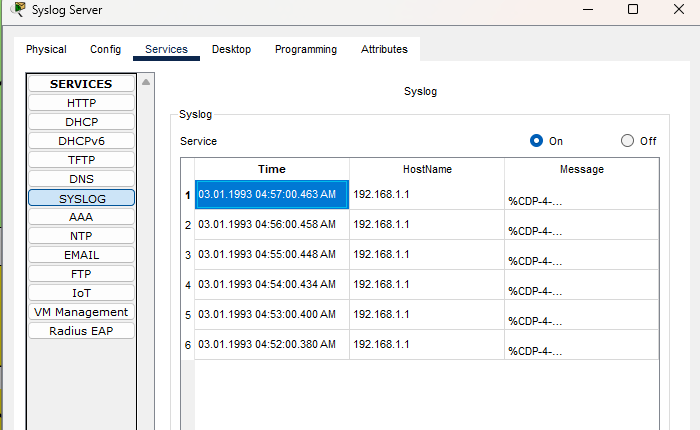
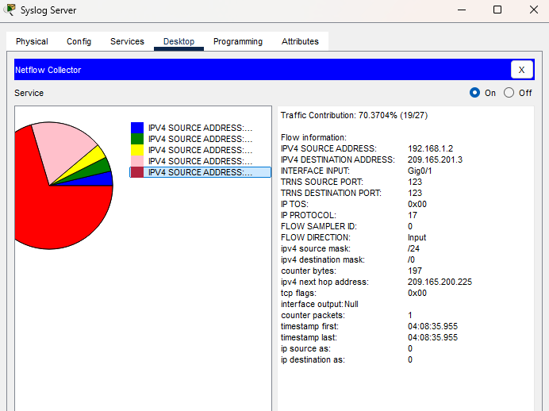
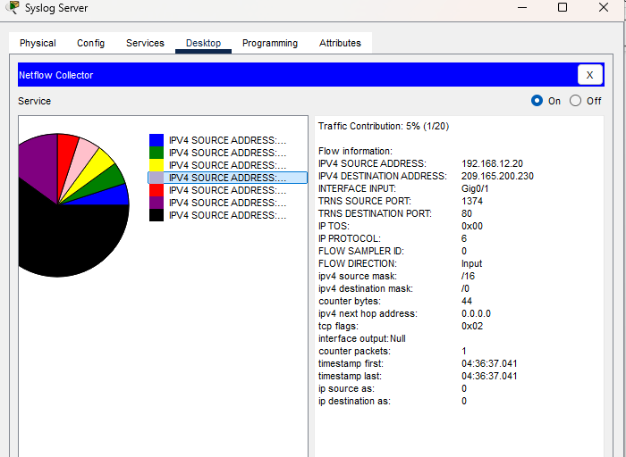
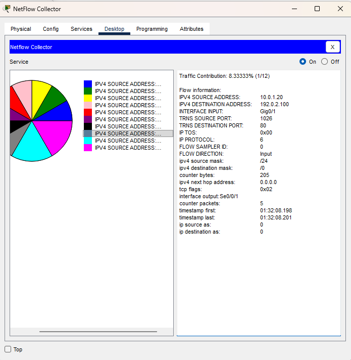

# Três fontes de dados de rede: syslog, contabilidade AAA e NetFlow

> Série de laboratórios 042 e 044 · mai/2026 a jun/2026 · Evidência direta (captura de tela própria ou saída de terminal copiada na entrega)
>
> Página no portfólio: https://juli084.github.io/cybersecurity-portfolio/laboratorios/syslog-aaa-netflow/

## Objetivo

Gerei eventos em uma rede simulada e li o que cada fonte registrou: mensagens de sistema no servidor syslog, início e fim de sessão administrativa no AAA e fluxos de tráfego no coletor NetFlow.

- Enviar mensagens de equipamentos para um servidor syslog e ler os campos
- Observar o registro de uma sessão administrativa autenticada por servidor
- Gerar tráfego e ler os registros de fluxo no coletor
- Repetir a coleta de fluxos em um segundo cenário

## Cenário

Um analista raramente tem uma fonte só. Syslog diz o que o equipamento relatou, a contabilidade AAA diz quem entrou e quando, e o NetFlow diz quem falou com quem. Nenhuma das três mostra o conteúdo; juntas, mostram o comportamento.

## Ambiente

- Cisco Packet Tracer (rede simulada)

## Tecnologias

syslog, NetFlow, TACACS+, ICMP, HTTP, Telnet, NTP

## Ferramentas

Cisco Packet Tracer, Cisco IOS

## Procedimento

1. 042: ativei uma depuração no roteador e conferi as mensagens chegando ao servidor syslog.
2. 042: entrei em outro roteador com uma conta autenticada por TACACS+, saí, e li os registros de início e fim de sessão.
3. 042: gerei ping, acesso web e tentativas de Telnet a partir de várias estações, incluindo uma estação fora da rede interna, e li os fluxos no coletor.
4. 042: montei uma tabela de destino, porta e serviço das tentativas que não tiveram resposta.
5. 044: em um segundo cenário, repeti pings e acessos web entre estações e registrei os fluxos correspondentes.

## Evidências

*042: mensagens recebidas pelo servidor syslog. Cada entrada traz horário, host de origem e o texto da mensagem.*

*042: coletor NetFlow. O fluxo selecionado é UDP na porta 123, tráfego de sincronização de horário.*

*042: fluxo TCP para a porta 80. As flags registradas mostram apenas o início da conexão.*

*044: segundo cenário, com um fluxo para cada par de estações testado.*

## Análise técnica

| Fonte | O que registra | Pergunta que responde |
| --- | --- | --- |
| Syslog | Data e hora, equipamento de origem, mensagem | O que o equipamento relatou e quando |
| Contabilidade AAA | Usuário, início e fim da sessão, equipamento e linha de acesso | Quem entrou, por onde e por quanto tempo |
| NetFlow | Origem, destino, portas, protocolo, interface, bytes, pacotes, flags, horários | Quem falou com quem e quanto |

## Contabilidade AAA

Ao entrar no roteador com a conta de analista, o servidor registrou uma entrada com o usuário, o
horário, o endereço do roteador e a linha de console, marcada como início. Ao sair, uma segunda
entrada, marcada como fim. As duas juntas delimitam a sessão. Sem esse registro, a pergunta "quem
alterou a configuração naquela hora" não tem resposta.

## Lendo um fluxo

Um registro de fluxo resume uma conversa em uma direção. Para um acesso web aparecem dois: o pedido,
saindo, e a resposta, voltando, com as interfaces de entrada e saída invertidas. Quando o acesso é
por nome e não por IP, surge antes um terceiro fluxo, na porta 53, que é a consulta DNS.

## O que foi barrado

A partir de uma das estações, várias tentativas não tiveram resposta:

| Serviço | Porta | Situação |
| --- | --- | --- |
| ICMP (ping) | não se aplica | Sem resposta para uma estação de outra rede |
| HTTP | 80 | Sem resposta de um servidor web |
| Telnet | 23 | Sem resposta de três endereços |

Do ponto de vista de quem monitora, o interessante é a combinação. Uma estação que tenta Telnet em
três endereços diferentes e não consegue em nenhum está procurando acesso administrativo. Nenhuma
tentativa isolada chamaria atenção.

## Horário

As mensagens do syslog chegaram com data de 1993, porque os equipamentos do simulador não estavam
com o relógio ajustado. Em uma rede real isso inviabilizaria cruzar o syslog com as outras duas
fontes, e é o motivo de o NTP ser o primeiro serviço a configurar quando se centraliza log.

## Resultado

As três fontes registraram os eventos gerados. As tentativas sem resposta foram tabuladas por destino, porta e serviço.

## O que aprendi

NetFlow não guarda conteúdo, e mesmo assim responde muito: quem iniciou, para onde, por qual porta, quantos pacotes e por quanto tempo. Um fluxo TCP só com o primeiro pacote é uma conexão que não se completou, e muitos assim em sequência são varredura.

## Competências demonstradas

- `leitura-de-logs`
- `netflow`
- `aaa-tacacs-radius`

A relação entre competências e laboratórios está em [docs/skills-matrix.md](../../docs/skills-matrix.md).

## Frameworks relacionados

Relação com o que foi praticado. Não indica exercício profissional da função.

- **NIST CSF 2.0:** DE.CM (Continuous Monitoring); DE.AE (Adverse Event Analysis)
- **NICE Framework:** tarefas relacionadas às funções Defensive Cybersecurity, Network Operations

## Referências

- [RFC 5424: protocolo syslog](https://www.rfc-editor.org/rfc/rfc5424)
- [RFC 3954: Cisco NetFlow versão 9](https://www.rfc-editor.org/rfc/rfc3954)
- [RFC 8907: protocolo TACACS+](https://www.rfc-editor.org/rfc/rfc8907)

## Limitações

- A 044 tem só as capturas, sem análise escrita na entrega.
- Fiz também uma atividade de análise de fluxos com previsão dos campos antes de gerar o tráfego. Ela ficou fora deste portfólio por pendência de conferência da entrega.
- O Packet Tracer simula uma versão simplificada do NetFlow, e os registros de um equipamento real têm mais campos.

## Para reproduzir

- Cisco Packet Tracer com servidor configurado como coletor syslog e NetFlow.

## Considerações éticas

Atividade realizada em ambiente acadêmico, controlado e autorizado, com finalidade educacional. Veja [docs/ethics.md](../../docs/ethics.md).

---

*Arquivo gerado a partir de `lab.md` por `npm run readmes`. Edite o `lab.md`.*
