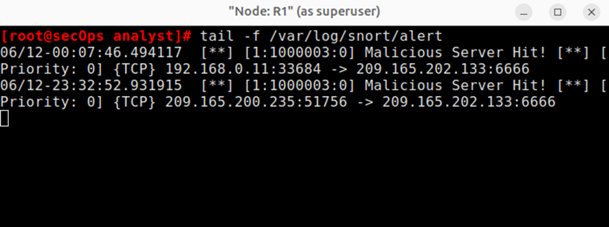
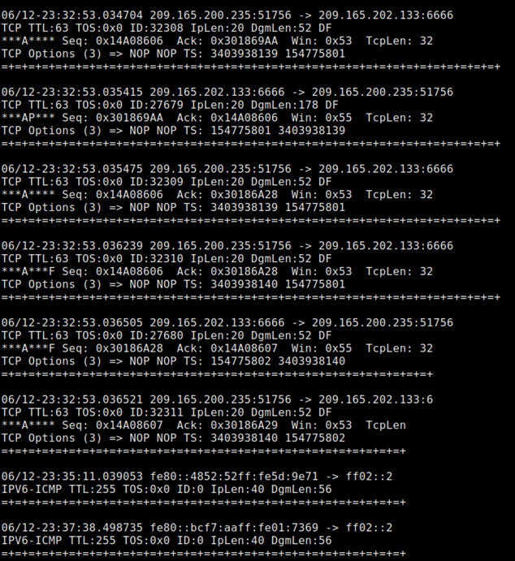
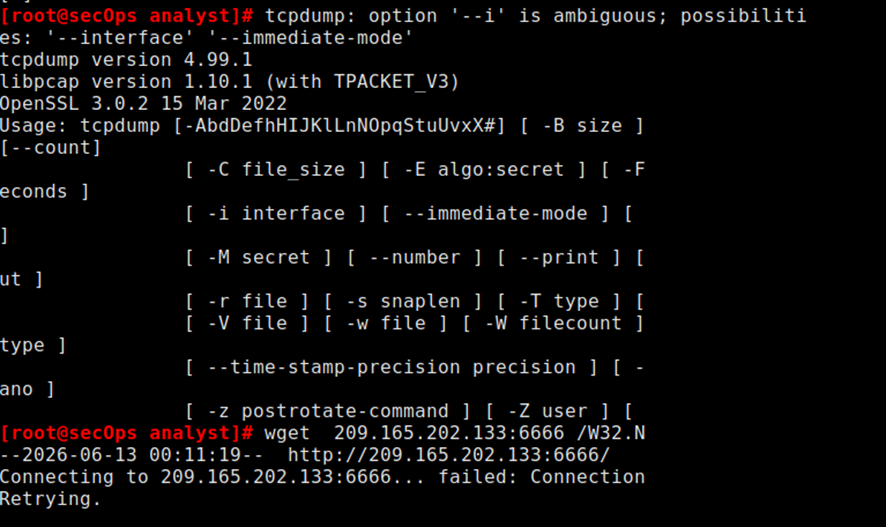

# Alertas do Snort, captura com tcpdump e bloqueio com iptables

> Laboratório 043 · jun/2026 · Evidência direta (captura de tela própria ou saída de terminal copiada na entrega)
>
> Página no portfólio: https://juli084.github.io/cybersecurity-portfolio/laboratorios/snort-tcpdump-iptables/

## Objetivo

Simulei o download de um arquivo malicioso numa rede emulada, li o alerta que o IDS gerou, gravei o tráfego em PCAP e bloqueei a comunicação no firewall do roteador.

- Subir a topologia emulada e identificar onde o IDS e o firewall atuam
- Gerar tráfego suspeito e ler o alerta correspondente
- Capturar a transação em arquivo para análise posterior
- Bloquear a comunicação e confirmar o efeito

## Cenário

Em uma rede de produção, alertas chegam de fontes diferentes e em formatos diferentes. O cenário reproduz isso em escala pequena: hosts internos, servidores em uma DMZ e servidores externos, um deles hospedando malware. No meio fica um roteador que acumula os papéis de firewall e de IDS.

## Ambiente

- VM Linux de laboratório (VirtualBox)

## Tecnologias

TCP, HTTP, ICMP, IPv4

## Ferramentas

Snort, tcpdump, iptables, Mininet, netstat, wget

## Procedimento

1. Subi a topologia no Mininet e abri terminais nos nós que interessavam (roteador, servidor da DMZ e servidor externo).
2. Com netstat, identifiquei a porta em que o servidor externo atendia.
3. Deixei o arquivo de alertas do Snort aberto com tail -f em um terminal do roteador.
4. A partir do servidor da DMZ, baixei o arquivo de teste com wget e acompanhei o alerta aparecer.
5. Iniciei uma captura com tcpdump gravando em PCAP e repeti o download.
6. Consultei as chains em uso no iptables do roteador, bloqueei a comunicação e tentei o download de novo.

## Evidências

*Arquivo de alertas do Snort acompanhado em tempo real. Cada linha traz horário, identificador da regra, mensagem, protocolo e os pares de endereço e porta.*

*Pacotes da transação capturados com tcpdump, com flags, números de sequência e opções TCP.*

*Depois do bloqueio, o wget não consegue mais abrir a conexão. A mesma tela mostra um erro de sintaxe meu no tcpdump, corrigido na sequência.*

## Análise técnica

O alerta tem cinco informações que importam: quando, qual regra, de onde, para onde e por qual porta.
Na captura aparecem dois:

| Campo | Primeiro alerta | Segundo alerta |
| --- | --- | --- |
| Origem | host interno, porta 33684 | servidor da DMZ, porta 51756 |
| Destino | servidor externo, porta 6666 | servidor externo, porta 6666 |
| Protocolo | TCP | TCP |
| Mensagem da regra | Malicious Server Hit! | Malicious Server Hit! |

Três coisas chamam atenção.

**A porta de destino.** 6666 não é porta de serviço web. Um download HTTP nessa porta já justifica
olhar com cuidado, e é o que a regra do cenário faz: ela dispara pelo destino, não pelo conteúdo.

**Quem iniciou.** As duas conexões saíram de dentro: uma estação interna e um servidor da DMZ. Um
servidor que busca arquivo num destino suspeito é um sinal mais forte do que uma tentativa vinda de
fora.

**O que o IDS não fez.** O arquivo chegou inteiro. O Snort estava em modo de detecção, então o
alerta é só o registro. Para interromper foi preciso agir no firewall do roteador, que tinha as
chains INPUT, OUTPUT e FORWARD em uso. Como o roteador encaminha tráfego entre redes, é na FORWARD
que esse bloqueio faz efeito.

O PCAP serve para o que o alerta não mostra: a sequência completa dos pacotes, os tamanhos e o
conteúdo transferido, que podem ser abertos depois em outra ferramenta sem depender de uma linha de
log.

## Resultado

O primeiro download terminou e gerou alerta. Depois do bloqueio no roteador, a mesma tentativa falhou na conexão. O tráfego da transação ficou gravado em PCAP.

## O que aprendi

Detectar e bloquear são coisas diferentes: o IDS viu tudo e não impediu nada. Também aprendi a conferir os dados do alerta na própria tela antes de escrevê-los num relatório, porque na entrega original misturei valores de dois alertas diferentes.

## Competências demonstradas

- `alertas-de-ids`
- `analise-de-pacotes`
- `firewall-de-host`
- `leitura-de-logs`

A relação entre competências e laboratórios está em [docs/skills-matrix.md](../../docs/skills-matrix.md).

## Frameworks relacionados

Relação com o que foi praticado. Não indica exercício profissional da função.

- **NIST CSF 2.0:** DE.CM (Continuous Monitoring); DE.AE (Adverse Event Analysis); RS.MI (Incident Mitigation)
- **MITRE ATT&CK:** T1105 Ingress Tool Transfer; T1571 Non-Standard Port
- **NICE Framework:** tarefas relacionadas às funções Defensive Cybersecurity

## Referências

- [Snort 3: documentação](https://docs.snort.org/)
- [tcpdump: página de manual](https://www.tcpdump.org/manpages/tcpdump.1.html)
- [netfilter/iptables: documentação](https://www.netfilter.org/documentation/)

## Limitações

- A regra exata que usei no iptables não ficou registrada na entrega.
- O Snort já estava configurado no cenário. Li e interpretei alertas; não escrevi regras.
- Bloqueei a comunicação observada. Em produção eu bloquearia o destino inteiro, porque nada impede o mesmo servidor de usar outra porta.

## Para reproduzir

- VM Linux de laboratório com Mininet, Snort, tcpdump e iptables.
- A topologia vem de um script do material do curso, que não redistribuo.

## Considerações éticas

Atividade realizada em ambiente acadêmico, controlado e autorizado, com finalidade educacional. Veja [docs/ethics.md](../../docs/ethics.md).

---

*Arquivo gerado a partir de `lab.md` por `npm run readmes`. Edite o `lab.md`.*
